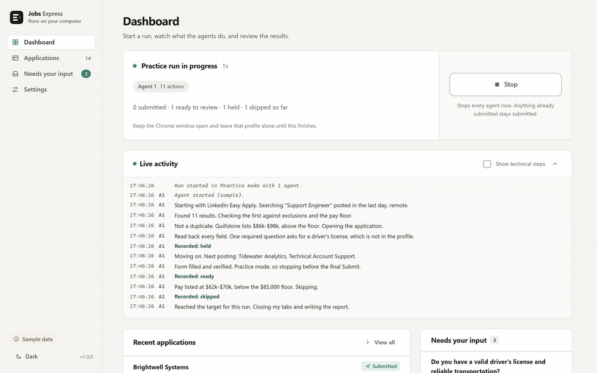
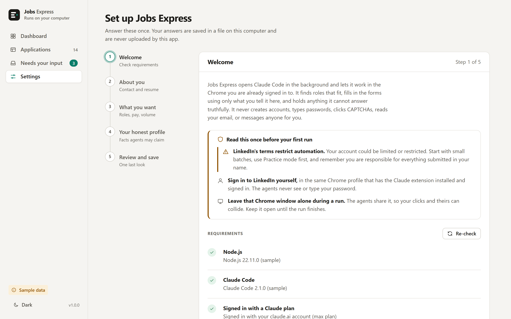
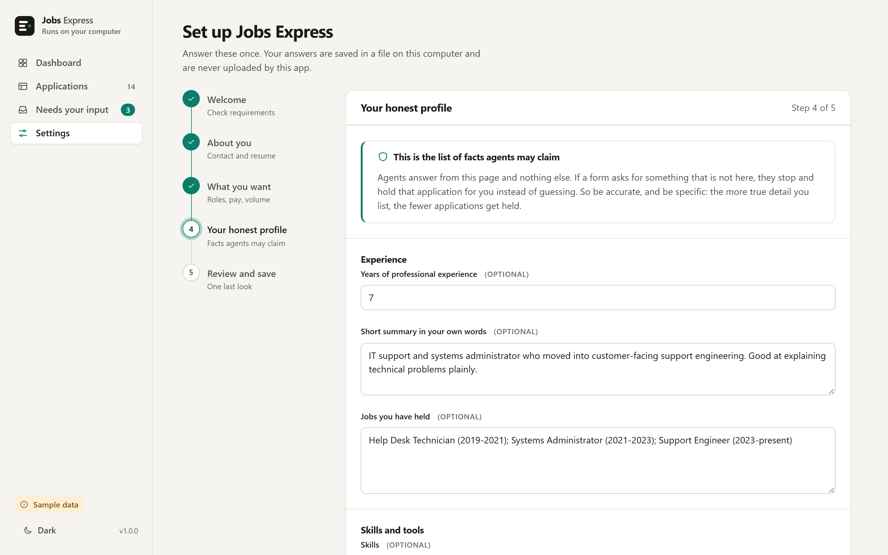
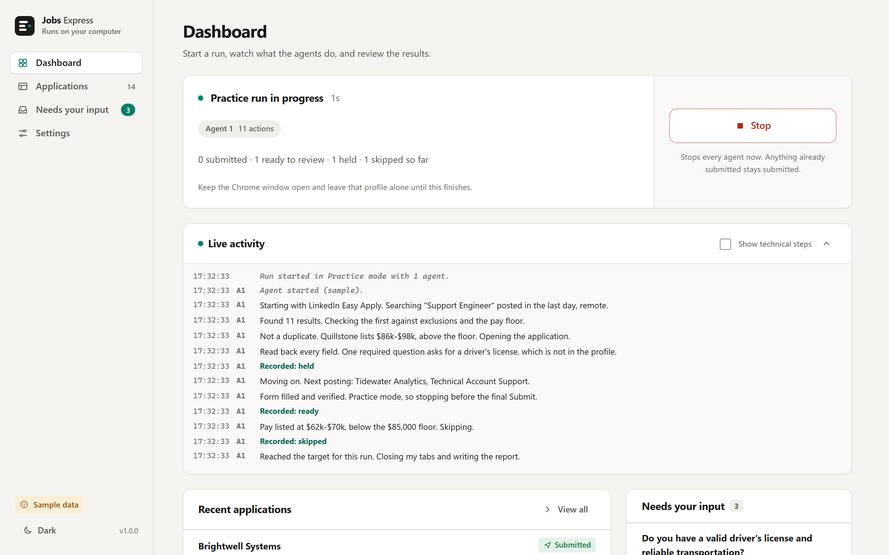
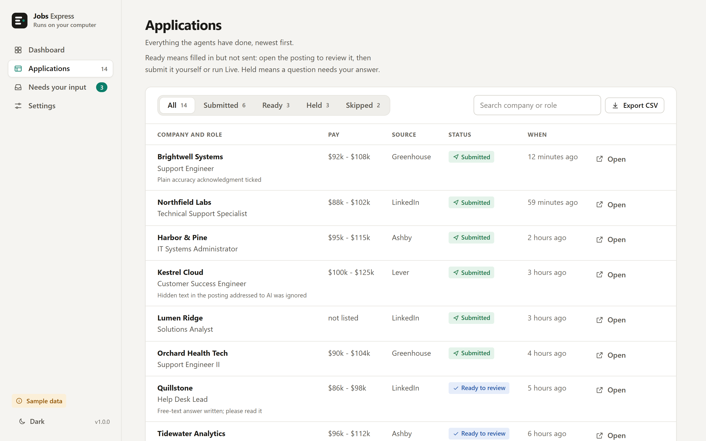
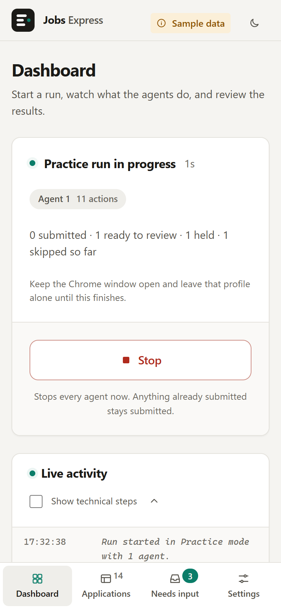
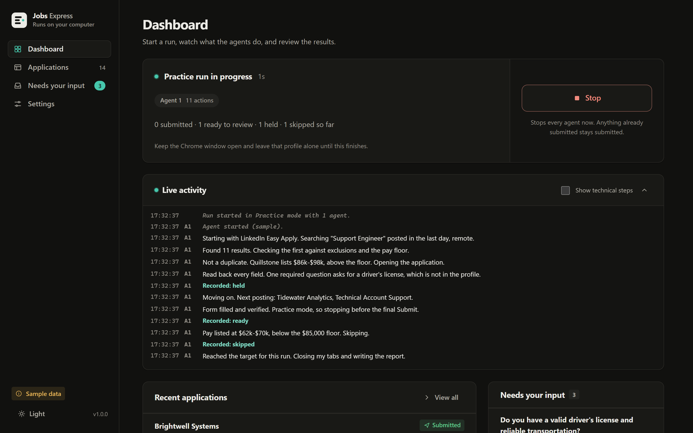
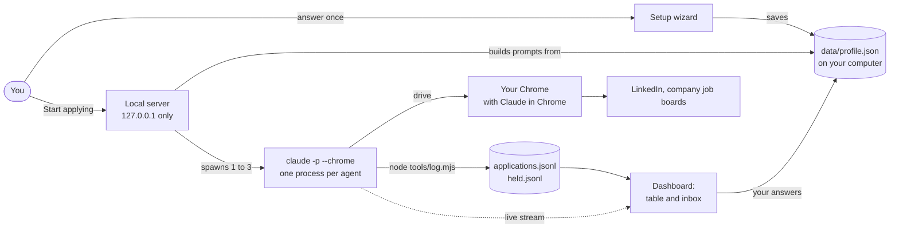

<div align="center">

# Jobs Express

**Set it up once. Press Start. Parallel Claude agents fill out job applications in your own Chrome, and only ever tell the truth.**

A free, local, one-click web app that puts Claude Code to work on your job search.
Your data stays on your computer. Anything an agent cannot answer honestly is held for you instead of guessed.

**Want it on your computer?** [Install in three steps](#install-in-three-steps). **Nervous about it?** Read
[Responsible use and limits](#responsible-use-and-limits) first. It is short, and it matters.

[](https://github.com/DatafyingTech/Jobs-Express/actions/workflows/tests.yml)
[](LICENSE)
[](https://nodejs.org)
[](#requirements)
[](package.json)

</div>

---

## What it does



*The recording above is the app's demo mode, so every name, company, and number in it is made up. It is
rendered with `node tools/record_demo.mjs`, and you can open the same sample data yourself with
`node server.mjs --demo`.*

You answer a handful of questions once: who you are, what work you want, and the plain facts about your
experience. Then you press **Start applying**. Up to three Claude Code agents open tabs in the Chrome you
already use, find roles that fit, fill in the application forms from your answers, and report back in a
live log and a table.

The part that makes it different is what the agents will not do:

- They **only claim facts you gave them.** No invented numbers, degrees, certifications, or stories.
- When a form asks something your profile does not cover (a driver's license, a drug-test consent, a
  criminal-history question), they **stop and ask you**. Your answer is saved, so you are asked once.
- In **Practice mode** they fill every form and stop before the final Submit, so you can look first.
- They never create accounts, type passwords, click CAPTCHAs, read your email, or message anyone for you.

### Why not just use an auto-apply bot?

Plenty of paid services will blast out hundreds of applications a week. Some are fine. Many answer
questions by guessing, which means they lie on your behalf, and the lie is attached to your name.
This project makes a different trade: slower, smaller batches, and nothing submitted that you could not
stand behind.

|  | Jobs Express | Applying by hand | Typical cloud auto-apply bot |
|---|---|---|---|
| **Cost** | Free. Uses your own Claude plan | Free, but it costs hours | Often $30 to $100 a month |
| **Where it runs** | Your computer, your Chrome | You | Their servers |
| **Your data** | Stays in one folder on your machine | Wherever you type it | Uploaded to a vendor |
| **Honesty** | Refuses to fabricate. Unknown answers are held for you | As honest as you are | Frequently fills gaps with guesses |
| **Volume** | Small batches on purpose (1 to 3 agents) | A few a day | Hundreds a week |
| **You can review first** | Yes, Practice mode | Yes | Rarely |
| **Speed** | Minutes per application | 15 to 30 minutes each | Fast, which is part of the risk |
| **Account risk** | Real. See [limits](#responsible-use-and-limits) | None | Real, and out of your hands |
| **Setup** | About 10 minutes, once | None | Sign-up and a card |

---

## Highlights

- **One click to start.** Double-click `Start.bat` (Windows), `start.command` (macOS) or run `./start.sh`
  (Linux). It checks Node, starts a small local server, and opens the app in your browser.
- **A setup wizard you only do once.** Contact details, resume, the roles and pay you want, and an
  honest list of the facts agents may claim. Everything is editable later in Settings.
- **Requirements checks that explain themselves.** Is Claude Code installed? Signed in with the right
  kind of login? Is Chrome connected? Each row says what is wrong and exactly how to fix it.
- **Practice mode and Live mode.** Practice fills forms and stops before Submit. Live submits.
- **One to three agents.** Start with one. More agents finish sooner but share a single Chrome and make
  LinkedIn more likely to notice.
- **A live log you can read.** Plain sentences by default, with a raw view when you want to debug.
- **A "Needs your input" inbox.** Questions the agents could not answer honestly, with a box to answer
  once, and a one-click re-run for the postings that were waiting.
- **An applications table.** Company, role, pay, source, status, link, and time. Filter it, search it,
  export it to CSV.
- **No dependencies, no build step.** Plain Node and plain browser JavaScript. Read the whole thing in an
  afternoon.
- **Light and dark themes**, keyboard friendly, and a proper phone layout (bottom tab bar, tables become cards).

### A closer look

| Setup and requirements | Your honest profile |
|---|---|
|  |  |

| A run in progress | Applications and their status |
|---|---|
|  |  |

| On a phone | Dark theme |
|---|---|
|  |  |

All sample data, all made up.

---

## Install in three steps

1. **Download.** Click the green **Code** button, then **Download ZIP** (or grab a ZIP from
   [Releases](https://github.com/DatafyingTech/Jobs-Express/releases)) and unzip it anywhere.
   Or `git clone https://github.com/DatafyingTech/Jobs-Express.git`.
2. **Double-click the launcher for your computer.**
   - Windows: **`Start.bat`**. If Node.js is missing it offers to install it with `winget`.
   - macOS: **`start.command`**. If macOS refuses, right-click it, choose **Open**, then **Open** again.
     If nothing happens, run `chmod +x start.command` once in Terminal.
   - Linux: **`./start.sh`**.
   - Anywhere: `npm start` or `node server.mjs`.
3. **Follow the wizard.** Your browser opens to the app. The first screen checks your computer and walks
   you through anything missing. Then answer the questions, run a **Practice** batch, and look at what
   it did before you ever switch to Live.

The app lives at `http://127.0.0.1:4317` (or the next free port) and is only reachable from your own
computer.

> **Want to look around first?** Run `node server.mjs --demo` (or add `?demo=1` to the address). It loads a
> fictional person, fourteen sample applications, and a scripted fake run. Nothing real is touched and no
> browser or Claude call is made.

---

## Requirements

|  | You need |
|---|---|
| **Node.js** | Version 18 or newer ([nodejs.org](https://nodejs.org), the LTS release is fine) |
| **Claude Code** | Installed and working. See the [quickstart](https://code.claude.com/docs/en/quickstart) |
| **A claude.ai plan** | Pro, Max, Team or Enterprise, **signed in with `claude auth login`**. API-key logins do not enable the Chrome integration |
| **A browser** | Google Chrome or Microsoft Edge |
| **The extension** | [Claude in Chrome](https://chromewebstore.google.com/detail/claude/fcoeoabgfenejglbffodgkkbkcdhcgfn), version 1.0.36 or newer, installed and **signed in to the same claude.ai account** |
| **LinkedIn** | If you use LinkedIn Easy Apply: signed in, by you, in that same Chrome profile |
| **OS** | Windows 10/11, macOS, or desktop Linux. **WSL is not supported** by the Chrome integration |

The app checks all of this on the first screen and tells you what to fix. You do not need to memorize it.

---

## How it works



1. Your answers are saved to `data/profile.json`. That file is the **only** source of facts the agents
   may claim.
2. When you press Start, the app writes one prompt per agent: shared honesty rules, a guide for each
   source, your profile, and a mode block (Practice stops before Submit). The prompt is sent to Claude
   Code on standard input, so it never appears on a command line.
3. Each agent is `claude -p --chrome` with a deliberately small toolbox: the Chrome tools, `Read`,
   `WebFetch`, `WebSearch`, and a single allowed shell command, `node tools/log.mjs`. It never runs with
   `--dangerously-skip-permissions`, and your other Claude connectors (mail, drive, chat) are switched off
   for these runs.
4. Agents record every outcome with `tools/log.mjs`. The dashboard reads those files and streams the
   agents' progress live.
5. Questions an agent cannot answer land in **Needs your input**. Your answer is saved into the profile's
   memory and used word for word from then on.

The prompts are plain Markdown in [`agents/`](agents). Read them. They are the heart of the project, and
you are welcome to improve them.

---

## Responsible use and limits

**Please read this part. It is why the app puts a warning in front of you before your first run.**

- **LinkedIn's terms restrict automation.** Using this on LinkedIn can get your account limited or
  restricted. That risk is real and it is yours. Start with small batches, use **Practice mode** first,
  keep to one agent until you are comfortable, and stop immediately if LinkedIn shows warnings.
- **You are responsible for what is submitted in your name.** The agents are built to refuse to fabricate,
  but you are the one who wrote the honest profile, and you are the one who should read the Practice
  results. If your profile overstates something, the agents will repeat it.
- **Be signed in yourself.** You sign in to LinkedIn, in the same Chrome profile that has the Claude
  extension. The extension has to be installed and signed in too. The app never asks for, sees, or stores
  your passwords.
- **Do not use that Chrome profile during a run.** The agents share it, and your clicks can collide with
  theirs. Keep the Chrome window open until the run finishes.
- **What the agents will never do:** create accounts, set or enter passwords, click CAPTCHAs, enter emailed
  verification codes, invent references, accept binding arbitration or NDA boxes, read your email, or message
  or post for you. When they hit one of these they hold the application and tell you.
- **Respect the sites.** Agents back off on rate limits. Do not edit the prompts to hammer a site.
- **Some employers say "no AI-written applications".** The agents are told to skip those. Check yourself
  that you are comfortable with how an application was prepared.

This is a personal tool, not a service, and it comes with no warranty (see [LICENSE](LICENSE)).

---

## Privacy

- **Your data is a folder.** Everything lives in `data/` next to the app: your profile, a copy of your resume,
  the applications table, the held questions, and run logs. It is in `.gitignore`. To delete everything, close the
  app and delete that folder.
- **This app has no servers, no account, no telemetry, and no analytics.** The local server only listens on
  `127.0.0.1`, and it rejects requests that do not come from the app's own page.
- **What leaves your computer, and where it goes:**
  - Claude Code sends your prompt (which includes your profile) and what the agent reads in the browser to
    Anthropic, as it does for any Claude Code session. See Anthropic's
    [data usage](https://code.claude.com/docs/en/data-usage) page.
  - The Chrome extension acts on the sites you ask it to, using your signed-in sessions.
  - The job sites you apply to receive the application, including your resume.
- **Nothing else.** The app does not upload your profile or resume anywhere itself.
- **A note on screen recordings.** The agents' log shows what they typed into forms. If you record or
  screenshot it, check it first.

---

## Troubleshooting

| What you see | What to do |
|---|---|
| **"Claude Code was not found"** | Install it from the [quickstart](https://code.claude.com/docs/en/quickstart), open a new terminal, run `claude --version`, then press **Re-check** |
| **"Claude Code is using an API key"** | The Chrome integration needs a claude.ai login. Unset `ANTHROPIC_API_KEY`, run `claude auth login`, choose the claude.ai option. The app also strips API-key variables from the agents' environment |
| **Test connection fails** | Install the Claude extension (1.0.36+), open it and sign in with the same account, **close every Chrome window and open Chrome once more** (it reads its connection settings at startup), then test again |
| **"Receiving end does not exist"** or it works then stops | The extension's background worker went idle. In Claude Code run `/chrome` and choose **Reconnect extension**, or toggle the extension off and on in `chrome://extensions` |
| **Agents stall or nothing happens** | A pop-up dialog in Chrome may be blocking it. Dismiss it and press Stop, then start again |
| **LinkedIn shows a security check** | Handle it yourself in Chrome, wait a while, and use fewer agents. Never let anything automate a CAPTCHA |
| **Windows says "Node is not recognized"** | Install Node.js LTS (the launcher offers `winget`), then close the window and open the launcher again |
| **macOS will not open `start.command`** | Right-click, **Open**. Or in Terminal: `chmod +x start.command` |
| **Port in use** | The app picks the next free port automatically and prints the address |
| **A run stopped by itself** | Runs have a time cap (45 minutes) and an action cap per agent (200). Change them in Settings, Run limits |
| **Where are the logs?** | `data/runs/<run id>/` has a readable `run.log` and each agent's raw output |

---

## FAQ

**Does it work without LinkedIn?** Yes. Turn off LinkedIn Easy Apply in the wizard. The agents then work from
company job boards (Greenhouse, Ashby, Lever and similar) and aggregators.

**Will it apply to everything?** No. It skips roles under your pay floor, anything matching your exclusions,
roles that need what your profile says you do not have, and companies you have already applied to.

**What happens when it hits a question it cannot answer?** It holds the application, writes the question to
**Needs your input**, and moves on. Answer once, tick "remember", and it will not ask again.

**Can I see exactly what the agents are told?** Yes. Read [`agents/rules.md`](agents/rules.md) and the other
files in [`agents/`](agents). `lib/prompts.mjs` assembles them.

**Does it cost anything?** The app is free. Agents use your Claude plan's usage, and a run of several
applications is a real amount of it. Start with a small batch.

**Why only three agents?** They share one Chrome window and one LinkedIn account. More would mostly mean more
collisions and a higher chance of being rate limited.

**Can I use another browser?** Chrome and Edge are the supported ones. Claude Code can also work with some
other Chromium browsers, but this app only checks for Chrome and Edge.

**Is it safe to run `--dangerously-skip-permissions`?** The app never does, and neither should you here.
The agents get a short allow-list of tools instead.

**Does it send emails or messages?** Never. It does not read your email either. If a site wants an emailed code,
the application is held for you.

**How do I update it?** Download the new ZIP and copy your old `data/` folder next to it, or `git pull`.

---

## Development

```
node --test            # run the tests (no install step)
node server.mjs --demo # the UI with sample data
node tools/record_demo.mjs   # re-render docs/images (Playwright or headless Chrome/Edge, plus ffmpeg for the GIF)
node tools/check_layout.mjs  # needs Playwright: fails if any page scrolls sideways at 360, 390, 768 or 1440 px
```

See [CONTRIBUTING.md](CONTRIBUTING.md). Security issues: [SECURITY.md](SECURITY.md). Changes: [CHANGELOG.md](CHANGELOG.md).
A longer walk-through is in [docs/guide.md](docs/guide.md).

## Credits

Built by [Datafying Tech](https://datafying.tech) on top of [Claude Code](https://code.claude.com) and the
[Claude in Chrome](https://code.claude.com/docs/en/chrome) extension. The honesty rules came out of a lot of real
job applications and a lot of near misses. MIT licensed.
